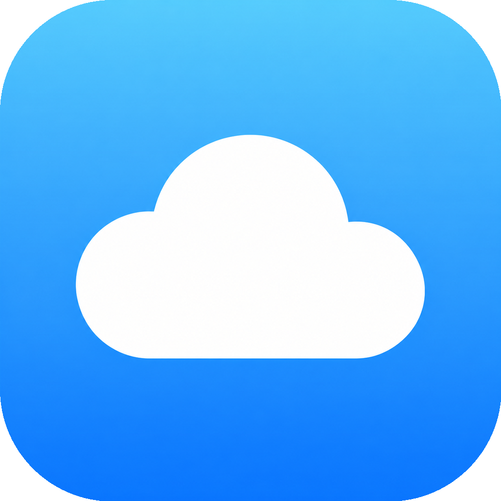

<div align="center">
  
  <h1>Bool</h1>
  <p>An iOS customization toolbox built on the <a href="https://github.com/forcequitOS/worse_query">worse_query</a> sandbox escape.</p>
  <a href="https://github.com/federicotaar/Bool/releases"></a>
</div>

---

## Overview

Bool modifies system features and appearance on supported iOS versions without a jailbreak. It writes to locations reachable through the worse_query sandbox escape, using an App Group container.

## Features

| Feature | Description |
| --- | --- |
| MobileGestalt tweaks | Toggle hidden device capabilities (Dynamic Island, Always-On Display, 80% charge limit, boot chime, internal build flags, and more). iOS 27 only. |
| Custom wallpapers | PosterBoard-based wallpaper collections, including MercuryPoster support. |
| Dialer themes | Custom keypad images for the Phone app. |
| Config tweaks | Additional system configuration toggles. |
| File browser | Browse and edit files inside reachable app containers. |

## Compatibility

| iOS / iPadOS | Support |
| --- | --- |
| 26.0 - 26.7.2 | Limited (no MobileGestalt tweaks) |
| 27.0 - 27.2.1 | Full |
| 27.3 beta 1 (24C5037i) | Full |

Compatibility depends on the worse_query escape remaining unpatched. A future iOS update may close it without notice. Beta releases (such as 27.3 beta 1) are verified as best effort and can break between beta builds.

## Installation

1. Download the latest unsigned IPA from [Releases](https://github.com/federicotaar/Bool/releases) (direct: [`Bool.ipa`](https://github.com/federicotaar/Bool/releases/latest/download/Bool.ipa)).
2. Sign it with your own Apple ID using SideStore, AltStore, Sideloadly, or a similar tool.
3. Enterprise or paid distribution certificates can break the App Group the app relies on and are not recommended.

A free Apple ID works but the app expires after 7 days: refresh it from your
signing tool (on the same Wi-Fi network) or reinstall. Details in
[docs/INSTALL.md](docs/INSTALL.md).

## Building from source

A macOS machine with Xcode 26 is required:

```sh
./ipabuild.sh
```

Or run the **Build Bool IPA** GitHub Actions workflow manually from the Actions tab, providing a new version number. The workflow produces an unsigned IPA and creates a non-overwriting release.

## Documentation

- [Install guide](docs/INSTALL.md) - sideloading with AltStore, SideStore or Sideloadly
- [Build from source](docs/BUILDING.md) - local builds and the release workflow
- [Tweak categories](docs/TWEAKS.md) - what each part of the app touches
- [FAQ](docs/FAQ.md) - reboots, compatibility, signing questions
- [App icon pipeline](docs/ICON.md) - how the Bool icon is built and verified
- [Releasing](docs/RELEASING.md) - versioning and publishing new builds
- [Changelog](CHANGELOG.md)

## Warnings

- **Back up your device before use.** Any tool of this kind carries a risk of data loss.
- MobileGestalt edits target the system's MobileGestalt cache. Whether they persist across a reboot depends on the write mode and iOS version behavior; the app includes an "Overwrite Atomically" option related to this.
- Some tweaks can render specific device configurations unstable or unusable. Read each in-app warning before enabling a tweak.
- Tweak behavior depends on the device and, in some cases, Apple's servers. A tweak not working is not necessarily a bug in the app.

## Repository structure

| Path | Contents |
| --- | --- |
| `Erosion/` | App source (target keeps the upstream name; see docs/FAQ.md) |
| `Erosion.xcodeproj/` | Xcode project |
| `.github/workflows/` | IPA build and icon verification workflows |
| `build-verification/` | Compiled-icon reports committed by CI |
| `docs/` | Install, build, tweak and release documentation |
| `ipabuild.sh` | Local unsigned-IPA build script |

## License

[GNU General Public License v3.0](LICENSE)
